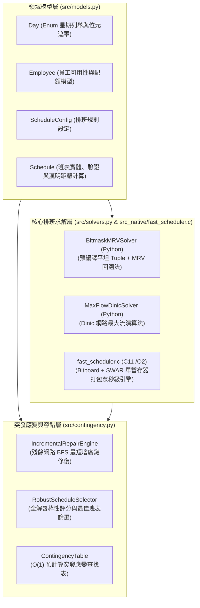

# 題目一：排班問題 — 系統架構與資料結構設計 (`02_architecture.md`)

## 1. 系統模組架構圖

本專案採用高內聚、低耦合的分層式架構設計，將「領域資料模型」、「核心排班求解器」、「突發狀況應變引擎」與「展示／測試介面」徹底分離，確保極致的執行效率與可維護性：

---

## 2. 核心資料結構與類別設計

### 2.1 `src/models.py` — 領域模型與不變量驗證
* **`Day(IntEnum)`**：將 `MON=0, TUE=1, WED=2, THU=3, FRI=4` 對應至整數索引，方便直接進行位元運算 `(1 << day)` 與陣列隨機存取 `O(1)`。
* **`Employee(dataclass, frozen=True)`**：
  * `name: str`：員工識別名稱。
  * `available_days: Tuple[Day, ...]`：員工可上班日。
  * `availability_mask: int`：自動預先編譯之位元遮罩（Bitmask），使得判斷「員工 $i$ 在第 $d$ 天是否有空」僅需一次位元及運算 `(mask >> d) & 1`，耗時為單一 CPU 週期。
* **`Schedule(dataclass)`**：
  * `assignments: Dict[Day, str]`：紀錄每天指派的員工。
  * `validate(config)`：嚴格檢查三大不變量（每天皆有人、皆在可用日內、每人不超過上限）。
  * `hamming_distance(other)`：計算兩個班表之間變動的天數，作為突發修復時「最小擾動（Minimal Perturbation）」的衡量指標。

### 2.2 `src/solvers.py` — 雙核心求解器（Strategy Pattern）
提供兩種不同演算法特性的求解器，共用一致的介面：
1. **`BitmaskMRVSolver`（位元遮罩 + MRV 回溯求解器）**：
   * 預先依據「每日可用人數」由小到大排序（MRV 啟發式），優先決定最受限的工作日。
   * 維護整數陣列 `work_count[emp_idx]`，在遞迴過程中進行 $O(1)$ 狀態更新與剪枝。
   * 支援 **單一最佳解快速搜尋 (`solve_one`)** 與 **全解空間完整枚舉 (`solve_all`)**。
2. **`MaxFlowDinicSolver`（Dinic 最大流求解器）**：
   * 建立分層網路（Level Graph）並使用當前弧優化（Current Arc Optimization）進行多路增廣。
   * 適合員工規模 $n$ 與排班天數 $D$ 擴增至大型企業級規模時，保證多項式時間 $O(E\sqrt{V})$ 穩定求解。

### 2.3 `src/contingency.py` — 突發狀況應變與容錯引擎
針對題目第 3 點「排好班表後，某位員工臨時說某天不能上了」，設計三階段完整的防禦與修復機制：
1. **階段一：殘餘網路最短增廣路徑修復 (`IncrementalRepairEngine.repair`)**：
   * 若請假員工當天本來就沒被排班 $\to$ **0-Hop 直接維持原班表（變動 0 天）**。
   * 若請假員工當天有排班 $\to$ 啟動廣度優先搜尋（BFS）在「日期 $\leftrightarrow$ 員工」交替圖中尋找最短替換鏈（Alternating Replacement Chain）：
     * **1-Hop（直接頂替，變動 1 天）**：尋找當天有空且本週排班數 $< 2$ 的員工直接接手。
     * **2-Hop（雙人換班，變動 2 天）**：尋找當天有空但已滿 2 天的員工 $Y$，將 $Y$ 在另一天 $d'$ 的班轉交給當天有空且未滿 2 天的員工 $Z$，再由 $Y$ 接手缺口。
     * **$k$-Hop（多階連鎖換班）**：自動延伸至任意長度，保證找出**變動天數最少（最小漢明距離）**的合法新班表。
2. **階段二：魯棒班表篩選器 (`RobustScheduleSelector`)**：
   * 對所有可行初始班表進行壓力模擬（模擬所有員工在所有可用日臨時請假），計算每個初始班表的「平均修復變動天數」與「1-Hop 直接代班成功率」，選出**最具韌性（Most Robust）**的推薦班表。
3. **階段三：`O(1)` 預計算應變查找表 (`ContingencyTable`)**：
   * 將推薦班表的所有突發情境預先算好並快取於雜湊表 `Dict[Tuple[str, Day], RepairResult]`，線上發生請假事件時可在 **`O(1)` 常數時間**內直接回傳替代班表與調度指令。

