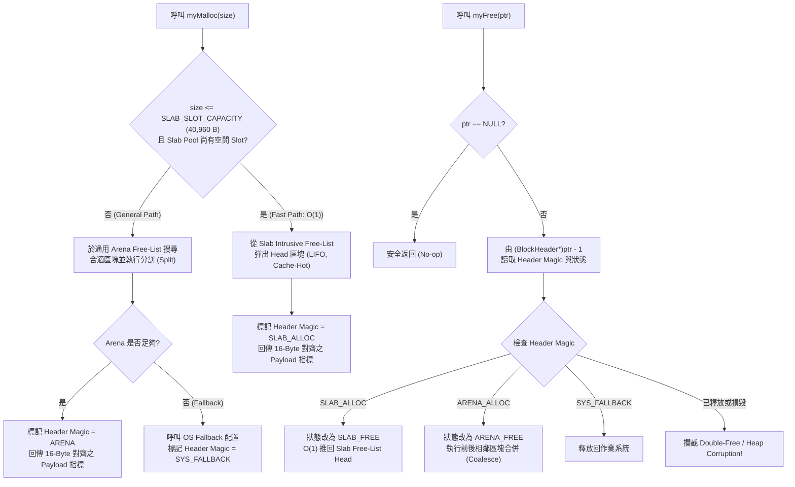

# 題目二：`myMalloc()` 系統架構與記憶體佈局設計 (`02_architecture.md`)

## 1. 雙層混合式配置器整體架構圖



---

## 2. 記憶體區塊標頭（Block Header）與對齊設計

為了讓 `myFree(void *ptr)` 在只拿到使用者指標 `ptr` 的情況下，能以 **$O(1)$ 時間** 知道該區塊屬於哪一層配置器、大小為何、以及是否發生 **重複釋放（Double-Free）** 或 **緩衝區溢位（Buffer Overflow）**，我們設計了緊湊且嚴格 **32-Byte（對齊 16-Byte 邊界）** 的 `MyBlockHeader`：

```text
+-----------------------------------------------------------------------+
|                        MyBlockHeader (32 Bytes)                       |
|  +------------------+------------------+--------------+------------+  |
|  | magic (uint32_t) | tier  (uint32_t) | size(size_t) | phys_prev/ |  |
|  |                  |                  |              | phys_next  |  |
|  +------------------+------------------+--------------+------------+  |
+-----------------------------------------------------------------------+
|               User Payload (16-Byte Aligned, e.g., 40,000 B)          |
|  <-- ptr 回傳給使用者的起始位址                                        |
|  * 當區塊處於 Allocated 狀態：完全供使用者讀寫                        |
|  * 當區塊在 Tier-2 Arena 處於 Free 狀態：前 16 Bytes 內嵌             |
|    ArenaFreeNode { free_prev, free_next } 顯式雙向自由串列指標！      |
+-----------------------------------------------------------------------+
```

### 2.1 關鍵安全性與效能設計細節
1. **Magic Number 雙重防護（防 Double-Free 與非法指標）**：
   * 分配中狀態：`MAGIC_ALLOCATED = 0x5543414C` (`"UCAL"`)
   * 已釋放狀態：`MAGIC_FREED     = 0x55434652` (`"UCFR"`)
   * 當使用者誤對同一個指標呼叫兩次 `myFree(ptr)` 時，第二次呼叫會立即偵測到 `header->magic == MAGIC_FREED`，主動攔截並計入 `double_free_detections` 計數器，避免破壞 Free-List 造成資訊安全漏洞。
2. **16-Byte 記憶體位址對齊（SIMD / AVX-128 Friendly）**：
   * 所有回傳給使用者的 `ptr` 均保證為 `16 Bytes` 的整數倍，不僅符合 x86_64 C ABI 規範，更能讓編譯器在處理 `int[10000]` 陣列運算時自動啟用 **SSE / AVX 向量化指令**。
3. **LIFO 熱快取回收（Cache-Warmth Optimization）**：
   * Slab Pool 的 `free_list_head` 採用堆疊式（LIFO）Push/Pop。當程式剛用完一塊 `40,000 Bytes` 陣列並呼叫 `myFree(ptr)`，緊接著下一次呼叫 `myMalloc()` 時，會立刻拿到**同一塊還在 CPU L1/L2 Cache 中的記憶體**，徹底消除 Cache Miss！

