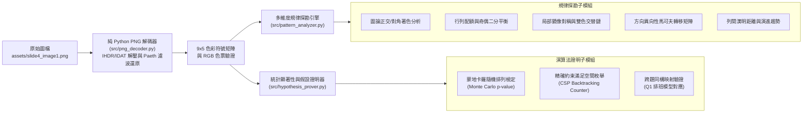

# 題目三：分析歸納題 — 系統架構與分析管線設計 (`02_architecture.md`)

## 1. 自動化規律探勘與演算法證明管線圖

---

## 2. 模組職責劃分

1. **`src/png_decoder.py`（零第三方套件依賴之底層 PNG 影像解析器）**：
   * 直接使用標準庫 `struct` 與 `zlib` 解析 PNG 二進位串流，實作完整的 PNG Scanline 濾波還原演算法（`None`, `Sub`, `Up`, `Average`, `Paeth` 五種標準濾波器）。
   * 自動對 $9 \times 5$ 儲存格中心取樣，精確輸出每個格子的 Hex 色碼與符號矩陣。
2. **`src/pattern_analyzer.py`（核心特徵、趨勢與規則分析引擎）**：
   * 封裝圖論邊衝突檢測、行列邊際分布與資訊熵（Shannon Entropy）計算、棋盤奇偶二分統計、局部回文／三明治對稱性掃描、水平與垂直馬可夫轉移矩陣（Markov Transition Matrix）、以及列與列之間的漢明距離矩陣。
3. **`src/hypothesis_prover.py`（演算法證明與蒙地卡羅統計檢定器）**：
   * **證明實驗 1**：執行蒙地卡羅模擬與理論機率推導，證明在 `{G:13, B:12, R:10, Y:10}` 固定數量下，隨機排列達成「76 條正交邊零衝突」的機率 $< 10^{-10}$。
   * **證明實驗 2**：證明「右側 $7 \times 3$ 連續 7 列達成 `X-Y-X` 鏡像對稱」在隨機四色著色下的發生機率僅為 $(1/3)^7 = 1/2187 \approx 0.0457\%$。
   * **證明實驗 3**：計算水平與垂直方向同群配對（冷色 `{B,G}`、暖色 `{R,Y}`）的卡方獨立性檢定（$\chi^2$ Statistic），證明水平與垂直轉移具有顯著的方向異向性。
   * **證明實驗 4**：精確計數在給定每列左端 2 格與上方約束下，右半部對稱結構如何將每列可行解空間收斂至唯一解或極少數解。

