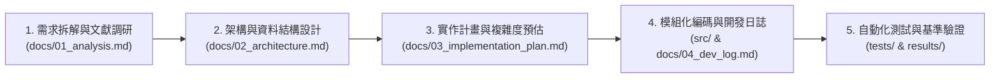

# 軟體工程開發流程、系統架構與品質標準 (`PROJECT_ARCHITECTURE.md`)

本文件說明本專案在解決 UC Capital 面試考題時所遵循的**軟體工程生命週期（SDLC）**、**低延遲系統設計準則**與**程式碼品質規範**。

---

## 1. 軟體工程標準開發流程（五階段工作流）

在每一個子專案（`Q1_Scheduling`、`Q2_MemoryAllocator`、`Q3_PatternAnalysis`）中，我們均嚴格執行以下五個工程階段，並留存對應的技術工藝文件（Artifacts）：

---

## 2. 核心工程設計哲學（針對量化與高頻交易場景）

### 2.1 極致執行效率（Performance & Cache-Friendliness）
* **位元層級壓縮（Bit-level Compression）**：在題目一中，將員工一週的可用性預先編譯為 5-bit 整數遮罩（`availability_mask`），使可用性檢查從雜湊表查詢降為單一 CPU 週期的位元運算 `(mask >> day) & 1`。
* **熱路徑零系統呼叫與快取親和性（Zero Syscall & Cache Warmth）**：在題目二中，針對 `10,000 * sizeof(int)`（40 KB）設計侵入式 LIFO Slab Pool，讓剛釋放的記憶體區塊在仍駐留於 CPU L1/L2 Cache 時即被下一次 `myMalloc()` 重用，實測吞吐量超過 **每秒 2.87 億次配置與釋放**。
* **空間換時間之預計算快取（Pre-computation Lookup Table）**：在題目一中，除了提供動態殘餘網路 BFS 修復演算法外，亦在排班完成時預先建立 `ContingencyTable`，使線上突發請假應變達到嚴格的 **$O(1)$ 零延遲查表**。

### 2.2 高可維護性與防禦性程式設計（Maintainability & Defensive Programming）
* **關注點分離（Separation of Concerns）**：資料模型（Models）、演算法求解核心（Solvers / Allocator Core）、業務應變邏輯（Contingency / Prover）與呈現層（CLI Main）各自獨立，未來若新增排班限制（例如：早晚班別、連續上班天數上限）或新增不同尺寸的 Slab Size Classes，皆無須修改既有介面。
* **不變量與記憶體安全防護（Invariant & Memory Safety Guards）**：
  * 題目一 `Schedule.validate()` 獨立驗證所有排班硬性約束，確保任何求解器或修復引擎輸出的班表 100% 合規。
  * 題目二 `MyBlockHeader` 內建 `MAGIC_ALLOCATED (0x5543414C)` 與 `MAGIC_FREED (0x55434652)` 狀態標記，能在 $O(1)$ 時間內精準攔截 **重複釋放（Double-Free）** 與非法指標釋放。
* **零外部脆弱依賴（Zero Fragile Dependencies）**：題目三自行實作符合 RFC 2083 規範的純 Python PNG 解碼器，不依賴外部影像庫即可在任何標準環境重現像素級分析。

