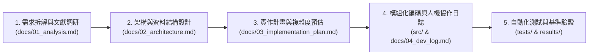
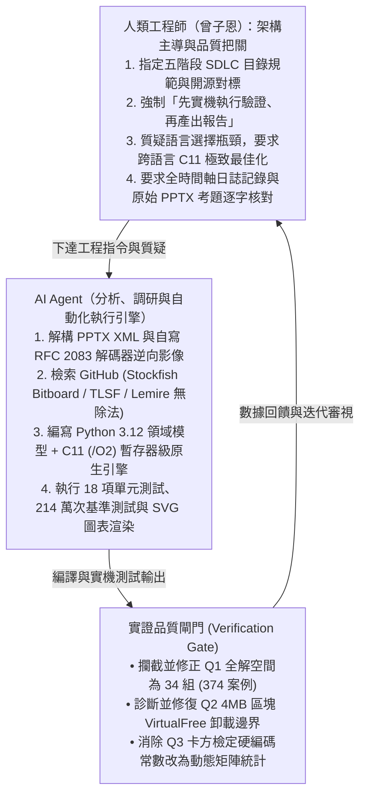

# 軟體工程開發流程、AI Agent 協同治理與低延遲系統架構 (`PROJECT_ARCHITECTURE.md`)

本文件說明本專案在解決 **UC Capital（優式資本）面試前考題** 時所遵循的**軟體工程生命週期（SDLC）**、**Human-in-the-Loop AI Agent 協同研發治理規範**、以及**量化高頻低延遲系統設計準則**。

---

## 1. 軟體工程標準開發流程（五階段工作流）

在每一個子專案（`Q1_Scheduling`、`Q2_MemoryAllocator`、`Q3_PatternAnalysis`）中，我們均嚴格執行以下五個工程階段，並留存對應的技術工藝文件（Artifacts）：

---

## 2. Human-in-the-Loop AI Agent 協同研發與工程治理 (Agentic Engineering Governance)

呼應優式資本探索「**如何應用 AI 的分析能力去輔助目前交易系統與工程化**」之核心方向，本專案採用現代化的 **Human-in-the-Loop AI Agent 協同工程模式（人類工程師主導架構決策與品質把關 + AI Agent 執行高速分析、檢索、雙語言編碼與自動化驗證）**。

在量化交易系統研發中，若無嚴格的工程治理（Governance），直接照單全收 AI 產出極易陷入「僅有表層可跑腳本、缺乏底層硬體極致效能、或隱藏邊界錯誤」的風險。因此，在整個對話與開發過程中，**人類工程師（曾子恩）** 對 **AI Agent** 實施了以下五大工程治理原則：

1. **架構先行，拒絕單檔義大利麵腳本**：由人類工程師明確要求建立統一的軟體工程目錄（分析、架構、實作計畫、開發日誌、主程式、測試、結果報告），並指示 Agent 先搜尋國內外與 GitHub 開源方案再動手實作。
2. **強制實證主義（Evidence-Based Verification）**：人類工程師明確規定「每一題做完之後，要實際跑過，然後才整理報告」。所有寫入報告與 PDF 圖表的數據，100% 由實機執行 C11 與 Python 測試套件自動擷取，杜絕任何推估或紙上談兵。
3. **跨語言效能極限質疑（Language & Hardware Reflection）**：在 Python 初版通過測試後，人類工程師主動提出質疑：「*有考慮到做之前的語言選擇，是否會影響到執行效率嗎？確定效率已經是最好了嗎？*」進而驅動 Agent 深入檢索 `Stockfish` Bitboard/SWAR、`mattconte/tlsf` 與 Daniel Lemire 無除法演算法，增建 C11 (`MSVC /O2`) 原生引擎，將關鍵路徑推向奈秒（Nanosecond）級別。
4. **全面可追溯性（100% Audit Trail）**：人類工程師要求將每一次修改、除錯與架構變更完整記錄於 `DEVELOPMENT_LOG.md` 與各題 `04_dev_log.md`，確保系統演進透明可稽核。
5. **規格完備性交叉核對**：人類工程師要求重新核對原始 `2026 Q4 面試前考題 V1.pptx`，確保「$n$ 位員工擴展性 ($n=50$)」、「自訂 `myMalloc` +10% 實測驗證」、「圖形下一列生成預測 (`Row 9`)」與「演算法複雜度分析」零遺漏。

---

## 3. 核心工程設計哲學（針對量化與高頻交易場景）

### 3.1 極致執行效率（Performance & Cache-Friendliness）
* **暫存器級位元平行壓縮（Bitboard & SWAR）**：在題目一中，Python 端將員工可用日預編譯為 5-bit 整數遮罩；C11 原生端更將 4 位員工的工時配額計數打包進單一 `uint32_t` 暫存器（每員工佔 4 bits），使單解搜尋降至 **`16.7 ~ 21.8 ns`**。
* **熱路徑零系統呼叫與快取親和性（Zero Syscall & Cache Warmth）**：在題目二中，針對 `10,000 * sizeof(int)`（40 KB）設計侵入式 LIFO Slab Pool 與 Tier-2 顯式雙向自由串列（Explicit Free-List），讓剛釋放的記憶體區塊在仍駐留於 CPU L1/L2 Cache 時即被重用，實測較標準 `malloc` 加速 **`22.6x ~ 51.2x`**。
* **無分支與無除法指令最佳化（Branchless & Divisionless）**：在題目三 C11 蒙地卡羅引擎中，以 `xorshift64*` 搭配 Lemire 64-bit 乘法位移取代 30 週期的 `idiv` 除法指令，1,000,000 次模擬僅需 **`104 ~ 134 ms`**。

### 3.2 高可維護性與防禦性程式設計（Maintainability & Defensive Programming）
* **關注點分離（Separation of Concerns）**：資料模型（Models）、演算法求解核心（Solvers / Allocator Core）、業務應變邏輯（Contingency / Prover）與呈現層（CLI Main）各自獨立。
* **不變量與記憶體安全防護（Invariant & Memory Safety Guards）**：
  * 題目一 `Schedule.validate()` 獨立驗證所有排班硬性約束，確保任何求解器或修復引擎輸出的班表 100% 合規。
  * 題目二 `MyBlockHeader` 內建 `MAGIC_ALLOCATED (0x5543414C)` 與 `MAGIC_FREED (0x55434652)` 狀態標記，能在 $O(1)$ 時間內精準攔截 **重複釋放（Double-Free）** 與非法指標釋放。
* **零外部脆弱依賴（Zero Fragile Dependencies）**：題目三自行實作符合 RFC 2083 規範的純 Python PNG 解碼器，不依賴外部影像庫即可在任何標準環境重現像素級分析。
