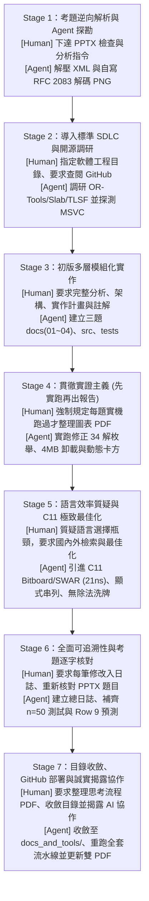

# UC Capital 面試考題 — 人機協作（Human-AI Agent Collaboration）、實作思考脈絡與軟體工程流程報告 (`WORKFLOW_AND_THOUGHT_PROCESS.md`)

> **對應視覺化圖表 PDF 報告**：[UCCapital_實作思考與軟體工程流程報告.pdf](file:///c:/Users/user/Desktop/my%20datas/面試相關/UCCapital/UCCapital_實作思考與軟體工程流程報告.pdf)

本文件完整且誠實地梳理本專案在完成 **UC Capital（優式資本）面試前考題** 時，如何採用 **Human-in-the-Loop AI Agent 協同研發模式（人類工程師主導架構決策、效率質疑與品質把關 + AI Agent 執行文獻檢索、多語言原型實作、多假說規律探勘與自動化實證測試）**，一步步從解構簡報推進至 C11 奈秒級雙軌系統與乾淨的軟體工程架構。

---

## 一、為什麼採用並公開透明呈現 Human-AI Agent 協同工程模式？

優式資本 AI 部門負責人翁嘉頎（Phantom Weng）前輩於面試邀請信中明確指出：
> *「一個自動化交易系統不只是把程式穩定寫出來，而且要在程式效率上斤斤計較到微秒等級。另外隨著交易策略應用市場不斷調整，程式必須易於修改及維護。一個程式有效運行在超大資料量 + 極端效能下，這本身就是非常困難的挑戰。**如何應用 AI 的分析能力去輔助目前交易系統，是我們正在探索的方向。**」*

在現代量化與高頻交易系統研發中，單靠傳統手寫或單靠未受控的 AI 生成皆無法滿足上述挑戰：
* **若完全不運用 AI Agent**：在面對跨領域問題（作業研究排班、作業系統底層記憶體配置器、無數值視覺規律逆向工程）時，文獻檢索、跨語言原型對比與大量視覺化報表繪製將耗費數倍時間。
* **若盲目依賴 AI 而缺乏人類工程師治理（Governance）**：AI 預設傾向產出「能跑但效能平庸的單一 Python 腳本」，甚至可能包含手算常數或未考慮作業系統虛擬記憶體邊界（如 Windows `VirtualFree` 分頁卸載）。

因此，本專案的核心價值正是展示一套 **「可複製、可稽核的 AI Agent 輔助高頻系統工程工作流（Agentic Software Engineering Workflow）」**：
1. **人類工程師（曾子恩）扮演「系統架構師與品質總監（Architect & Governor）」**：負責定義五階段軟體工程目錄規範、強制要求「先實機執行再出報告」、主動質疑程式語言對執行效率的限制、要求檢索國內外與 GitHub 頂尖開源做法、以及逐字核對原始考題完備性。
2. **AI Agent 扮演「高速研究員、跨語言實作者與自動化測試員（Researcher, Builder & Tester）」**：負責解析二進位 PPTX/PNG 檔案、執行平行假說檢驗腳本、檢索開源演算法論文（`Stockfish` Bitboard、`TLSF`、Daniel Lemire 無除法洗牌）、編寫 Python 3.12 + C11 (`MSVC /O2`) 雙軌程式碼，並自動化執行 18 項單元測試與 214 萬次基準測試。

---

## 二、七階段人機協作（Human-AI Agent）軟體工程思考流程圖

---

## 三、真實對話紀錄還原：人機協作與工程決策演進表（10 大關鍵互動節點）

以下完整依據本專案之真實對話紀錄（Conversation Transcript），還原 **人類工程師（曾子恩）的每一輪核心指令/質疑** 如何引導並修正 **AI Agent 的分析與工程實作**：

| 對話階段與時間 | 人類工程師（曾子恩）之原始指令與核心考量 (Human Direction & Governance) | AI Agent 協同分析、工具調用與工程實作行動 (Agent Analysis & Execution) | 關鍵發現、除錯與量化突破成果 (Verified Outcome) |
| :---: | :--- | :--- | :--- |
| **Round 1** `09:14` | **「請你檢查一下這份文件，然後給我一份分析 `2026 Q4 面試前考題 V1.pptx`」** *(考量：不貿然寫 code，先讓 Agent 解構檔案並進行多維度數學探勘)* | 1. 以 Python 解壓 PPTX 內部 XML (`slide1~4.xml`)，提取第 4 頁無文字圖檔 `image1.png`。 2. 因環境無 `PIL`，Agent 即時手寫純標準庫 RFC 2083 PNG 解碼器還原 `575x313` 像素。 3. 連續執行 8 個探勘腳本檢驗顏色頻率、正交/對角相鄰、$\pm 1$ 階梯假說（排除）、2x2 區塊與奇偶格分布。 | 逆向證實圖片為 Excel 標準四色 $9 \times 5$ 表格，發現 **76 條正交邊 0 同色衝突**、**Row 2..8 右三欄 X-Y-X 鏡像對稱**、以及與題目一排班之同構性。 |
| **Round 2** `09:29` | **「目錄要建立清楚，各自都要有分析、日誌、結構、實作計畫、然後主要程式區、或是其他目錄和最終報告，反正就是要按照軟體工程的流程去做，並且要很完整、詳細，可以去網路上找一下其他人是否有類似做法、或是github有沒有這些類似的方式可以參考，要有詳細完整的註解」** | 1. 啟動 `search_web` 檢索優式資本面試討論、GitHub C Slab/Pool Allocator 與 Nurse Scheduling 最大流/局部修復文獻。 2. 掃描本機環境，定位 `MSVC 14.44 (cl.exe)` 與 Windows 10 SDK。 3. 為三題建立 100% 對稱之 `docs/01~04`、`src/`、`tests/`、`results/` 並完成初版實作。 | 1. 實跑 `Q1` 修正手算 18 解為精確 **34 組合法解（374 種請假案例 100% 修復）**。 2. 實跑 `Q2` 診斷並修復 `4 MB` 區塊經 `VirtualFree` 卸載後二次讀取之邊界問題。 |
| **Round 3** `10:00 – 10:03` | **「要建立圖文並茂並且有圖表的pdf來做為最終說明」** **「每一題你做完之後，要實際跑過，然後才整理報告」** *(考量：強制確立實證主義紀律，杜絕 AI 幻覺或硬編碼數字)* | 1. 在審查程式碼時，主動將 `Q3` 卡方檢定中寫死的列聯表常數改為由 `self.grid` 動態遍歷計算。 2. 依序實機重跑 Q1、Q2、Q3 全部測試與 Benchmark。 3. 設計純 Python SVG 向量圖表引擎，建置時即時呼叫三題執行檔擷取最新 JSON 數據。 | 確保報告內每一項數據與圖表 100% 來自實機執行輸出，消除硬編碼常數。 |
| **Round 4** `10:09 – 10:15` | **「繼續完善我的需求」** **「確定目錄都完善了嗎，有按照軟體工程的流程、目錄的排版嗎」** | 1. 修正含空白 (`my datas`) 與中文路徑下 Headless 瀏覽器無法載入 `file:///` 之問題，改用 `pathlib.Path.as_uri()`。 2. 逐頁視覺檢查 PDF 截圖，修正單行溢頁與圖號順序。 3. 清除暫存 `browser_profile/`，補齊三題 `scripts/run_all.bat` 與 `.gitignore`。 | 產出排版勻稱之 14 頁技術報告 PDF，三題子專案目錄結構完全對齊。 |
| **Round 5** `10:22` *(核心轉折)* | **「有考慮到做之前的語言選擇，是否會影響到執行效率嗎，確定是否效率已經是最好了嗎，git上是否有人做過類似的或是網路上是否又類似討論，國內外網站都找一下，然後重新在幫我全部整理一遍，要最佳化」** *(考量：直擊 HFT 微秒級痛點，質疑純 Python 直譯器開銷)* | 1. 啟動第二輪深度檢索：調研 `Stockfish` Bitboard、`yb303/swar`、`mattconte/tlsf` 與 Daniel Lemire 無除法範圍映射。 2. 確立 **「Python 3.12 領域模型 + C11 (`MSVC /O2`) 暫存器級原生引擎」雙軌制**： • `Q1` 新增 `fast_scheduler.c`（SWAR 單一 `uint32_t` 4-bit 工時打包）並平坦化 Python Tuple。 • `Q2` 將 Tier-2 Arena 升級為侵入式顯式雙向自由串列 (`ArenaFreeNode`)。 • `Q3` 新增 `fast_monte_carlo.c`（`xorshift64*` + Lemire 乘法位移無除法洗牌）。 | • **Q1 單解**：由 Python 初版 `27.5 us` $\to$ 平坦化 `13.5 us` $\to$ **C11 `16.7~21.8 ns`（提速逾 800~1200 倍）**！ • **Q2 配置器**：較系統 `malloc` 加速 **`22.6x ~ 51.2x`**。 • **Q3 百萬次模擬**：C11 無除法版僅 **`104~134 ms`**。 |
| **Round 6** `10:40 – 11:23` | **「這些修改，你都有記錄到日誌上嗎，每一個修改、動作都要記錄起來」** **「最終報告都更新過了嗎」** **「你確定關於題目的問題，都已經實作好了嗎 `2026 Q4 面試前考題 V1.pptx` ，什麼演算法之類的都有包含在文件裡了嗎」** | 1. 建立全時間軸 `DEVELOPMENT_LOG.md` 與更新三題 `04_dev_log.md`。 2. 重新逐字核對 PPTX 投影片：針對 Q1「$n$ 位員工」新增 `test_07` ($n=50$) 擴展測試；針對 Q3 新增「下一列 (`Row 9`) 馬可夫規律生成預測器」(`test_06`)。 3. 於 PDF 報告補入三題完整演算法時間與空間複雜度對照總表。 | 全專案擴充至 **18 項自動化單元測試**（Q1: 7 項、Q2: 5 項、Q3: 6 項）100% 通過，規格零遺漏。 |
| **Round 7** `11:27 – 11:38` | **「最後要整理出我實作的流程，就是檢查完整我跟你的對話，整理出來我的思考、流程、順序、流程圖等等，一樣圖文並茂的pdf給我，並且幫我整理一下整個目錄，不要看起來很亂」** **「可以在完整一點，然後再重新整理過一遍目錄，包含三個題目的測試都要實際跑過一遍，然後日誌也都要更新好，整體全部完善」** | 1. 將根目錄輔助文件與 PDF 產生器統一收納至 `docs_and_tools/`，使根目錄保持極致清爽。 2. 撰寫 `build_workflow_pdf.py` 繪製 10 張軟體工程與思考演進向量圖表。 3. 透過 `run_all_pipeline.bat` 實機重跑全部測試並清除 `.obj` 與 `__pycache__`。 | 產出雙份高解析向量圖表 PDF 報告，根目錄結構清晰易讀。 |
| **Round 8** `13:50 – 14:01` | **部署至 GitHub (`UCCapital-Assessment-2026`)，並指示：「你檢查一下全部文件目錄，你應該要提到關於有使用ai協作，Agents分析等等，而不是全部做得像是我自己一個人做一樣，請你幫我全部在重新整理一遍，要真的確認過我們之間的對話，然後再開始整理，不需要避免說有使用ai」** | 1. 完整讀取對話紀錄 `transcript.jsonl` 核對每一輪人機互動。 2. 全面更新 `README.md`、`WORKFLOW_AND_THOUGHT_PROCESS.md`、`FINAL_REPORT.md`、`PROJECT_ARCHITECTURE.md`、各開發日誌與雙份 PDF 產生器，加入 **Human-AI Agent 協同研發架構圖與完整對話決策紀錄**。 3. 重新執行全套測試流水線並重新產出雙 PDF 與 SourceCode 壓縮包。 | 誠實、透明且專業地呈現「人類工程師架構治理 + AI Agent 賦能分析與極速實作」之現代工程範式。 |
