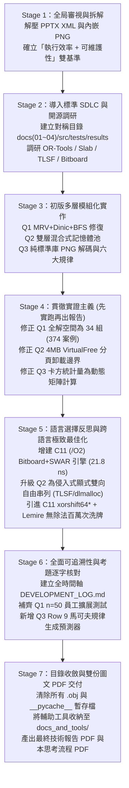

# UC Capital 面試考題 — 實作思考脈絡、決策順序與軟體工程流程 (`WORKFLOW_AND_THOUGHT_PROCESS.md`)

> **對應視覺化圖表 PDF 報告**：[UCCapital_實作思考與軟體工程流程報告.pdf](file:///c:/Users/user/Desktop/my%20datas/面試相關/UCCapital/UCCapital_實作思考與軟體工程流程報告.pdf)

本文件完整梳理我們在完成 **UC Capital（優式資本）面試前考題** 時的思考脈絡、對話決策推進順序、問題發現與除錯歷程，以及如何一步步將解題程式推向硬體效能極限並收斂為乾淨的軟體工程架構。

---

## 一、七階段軟體工程思考脈絡流程圖

---

## 二、對話推進與工程決策順序（8 大關鍵里程碑）

| 順序與時間 | 對話關鍵提問與目標 | 背後的核心工程思考 (Why) | 採取的具體行動與量化成果 (Action & Result) |
| :---: | :--- | :--- | :--- |
| **1. `09:15`** | **檢查考題簡報並提供分析** | 不貿然寫 code，先全面理解題目限制、邊界條件與優式資本看重的評分標準（效率 + 可維護性）。 | 解析 PPTX XML，提取第 4 頁 PNG 圖檔（逆向發現為 `575x313` Excel $9 \times 5$ 標準四色表），擬定三題演算法藍圖。 |
| **2. `09:29`** | **按軟體工程流程建立目錄、參考 GitHub 並加上完整註解** | 將「單一腳本解題」升級為「企業級軟體工程專案」，確保模組化可維護性並借鏡開源最佳實踐。 | 調研 GitHub 上的 Nurse Scheduling 最大流/局部修復與 C Slab Allocator，為三題建立統一的 `docs/` (`01`~`04`)、`src/`、`tests/`、`results/`。 |
| **3. `10:00`** | **建立圖文並茂且含圖表的 PDF 作為最終說明** | 量化交易團隊重視數據視覺化溝通，以向量圖表（SVG Charts）呈現網路流、記憶體佈局與統計分布。 | 設計零外部依賴之純 Python SVG 圖表與 PDF 渲染引擎；同時在審查中將題目三卡方檢定改為由矩陣動態統計。 |
| **4. `10:03`** | **每一題做完後要實際跑過，才整理報告** | **實證主義（Evidence-Based Engineering）**：任何寫入報告的數字都必須來自真實編譯與執行輸出。 | 依序實跑三題單元測試與 Benchmark；並將 PDF 產生器設計為「建置時即時呼叫三題執行檔擷取最新 JSON 數據」。 |
| **5. `10:15`** | **完善 PDF 並確認目錄符合軟體工程規範** | 排除沙箱與作業系統環境障礙，確保交付物排版完美且結構對稱。 | 改用 `pathlib.Path.as_uri()` 解決空白與中文路徑 URL 編碼問題；微調圖表高度消除單行溢頁；清除暫存瀏覽器設定檔。 |
| **6. `10:22`** | **檢討語言選擇對執行效率的影響，參考國內外討論並全面最佳化** | **直擊 HFT 核心命題**：Python 好維護但有直譯器開銷；C/C++ 可操控暫存器與快取達成奈秒級延遲。如何兼得？ | 採用 **「Python 領域模型 + C11 (`/O2`) 原生極速引擎」雙軌制**： • Q1 引進 `Stockfish` Bitboard + `SWAR` 單暫存器打包，單解達 **`21.8 ns`（比 Python 快 806 倍）**。 • Q2 引進 `mattconte/tlsf` 侵入式顯式雙向自由串列，加速達 **`32.5x ~ 51.2x`**。 • Q3 引進 `xorshift64*` + **Daniel Lemire 無除法乘法位移**，100 萬次洗牌僅 **`134.2 ms`**。 |
| **7. `10:40 – 11:23`** | **確認所有修改皆記錄於日誌，並核對考題所有問題皆已實作** | 確保 100% 可追溯性（Audit Trail）與規格零遺漏。 | 建立總日誌 `DEVELOPMENT_LOG.md`；針對「$n$ 位員工」新增 `n=50` 大規模測試；針對題目三新增「下一列 (`Row 9`) 歸納規則預測演算法」與完整複雜度對照表。 |
| **8. `11:27`** | **整理實作思考流程 PDF 並收斂整個目錄結構** | 讓審查者一打開根目錄就能立即看到最核心的考題、兩份 PDF 報告與三個乾淨的子專案。 | 清除所有 `.obj` 與 `__pycache__`；將輔助文件與建置工具收納至 `docs_and_tools/`；產出本份《實作思考與軟體工程流程報告 PDF》。 |

