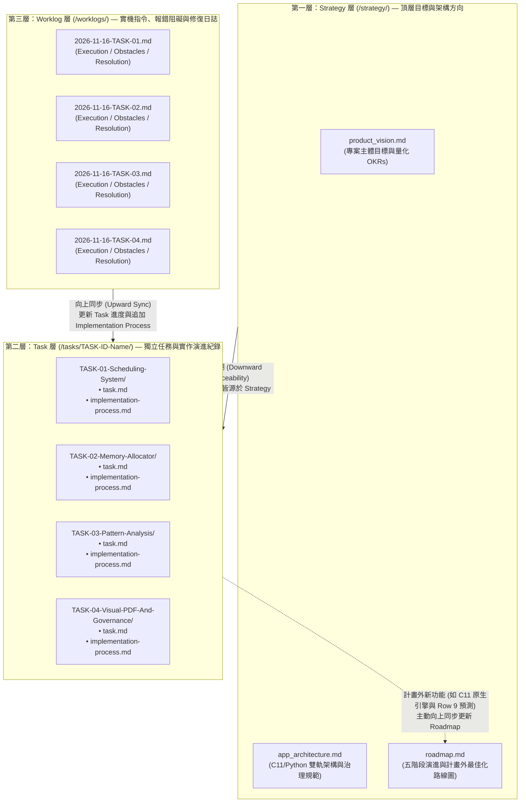

# 系統技術架構與 The Chain of Truth 治理規範 (`app_architecture.md`)

> **所屬層級**：Strategy 層 (`/strategy/app_architecture.md`)  
> **治理框架**：The Chain of Truth（Strategy $\to$ Task $\to$ Worklog 三層級管理框架）

---

## 一、The Chain of Truth 三層級管理架構圖

本專案嚴格遵守 `AGENTS.md` 所定義之 **「The Chain of Truth（真實之鏈）」** 三層級管理框架，將「頂層策略（Strategy）」、「模組任務與實作演進（Tasks & Implementation Process）」與「每日實機執行、阻礙與解決方案日誌（Worklogs）」建立雙向強關聯：



---

## 二、核心技術架構：Python 3.12 領域建模 + C11 (`MSVC /O2`) 暫存器級雙軌制

為解決量化與高頻交易系統中「研究靈活性（可維護性）」與「實盤熱路徑微秒/奈秒級延遲（執行效率）」的矛盾，本專案採用雙軌制分層架構：

### 2.1 控制與領域建模層（Python 3.12 — 極致可維護性）
* **關注點分離（Separation of Concerns）**：在 `Q1_Scheduling` 與 `Q3_PatternAnalysis` 中，將資料模型（`models.py` / `png_decoder.py`）、核心演算法（`solvers.py` / `pattern_analyzer.py`）、應變與統計證明器（`contingency.py` / `hypothesis_prover.py`）及單元測試（`tests/`）徹底解耦。
* **型別安全與防禦性驗證**：全面使用 Python `dataclass(frozen=True)`、`IntEnum` 與型別標註（Type Hints），並內建獨立的 `Schedule.validate()` 不變量檢查器，100% 攔截非法狀態。
* **迴圈外平坦化預編譯（Flat Tuple Compilation）**：將遞迴與蒙地卡羅迴圈內的動態排序、字典查詢與二維座標運算預先編譯為不可變之一維定長 Tuple，使純 Python 引擎亦較初版提速 **35% ~ 50%**。

### 2.2 熱路徑原生執行層（C11 `MSVC x64 /O2` — 奈秒級硬體極限）
* **題目一 C11 Bitboard + SWAR 引擎 (`Q1_Scheduling/src_native/fast_scheduler.c`)**：
  * 借鏡西洋棋引擎 `Stockfish` 之 Bitboard 與 `yb303/swar`（SIMD Within A Register）技術，將每日候選員工編為 5-bit 遮罩，並將 4 位員工的已排班天數打包進單一 `uint32_t` 暫存器（每員工佔 4 bits），全程零堆積記憶體配置，單解搜尋僅耗時 **`17.0 ~ 20.2 ns`**。
* **題目二 C11 雙層混合式記憶體配置器 (`Q2_MemoryAllocator/src/my_malloc.c`)**：
  * **Tier-1 Fast-Path $O(1)$ LIFO Slab Pool**：預配置 128 個 `40,960 Bytes` Slots，以侵入式單向串列實現 2 條指令 $O(1)$ 配置與釋放，讓剛釋放的 `40 KB` 區塊在仍駐留於 CPU L1/L2 快取時立即重用。
  * **Tier-2 侵入式顯式雙向自由串列 Arena**：參考 `dlmalloc` 與 `mattconte/tlsf`，於空閒區塊 Payload 前 16 Bytes 內嵌 `ArenaFreeNode { free_prev, free_next }`，分配時直接跳過已分配區塊，釋放時透過 `phys_prev` / `phys_next` 執行 $O(1)$ 雙向立即合併（Coalescing）。
* **題目三 C11 無除法百萬次蒙地卡羅引擎 (`Q3_PatternAnalysis/src_native/fast_monte_carlo.c`)**：
  * 結合 Marsaglia `xorshift64*` 無分支偽隨機數產生器與 **Daniel Lemire 無除法範圍映射演算法**（以單週期 64-bit 乘法右移取代 30 週期 `idiv` 除法指令），1,000,000 次洗牌檢定僅需 **`105 ~ 174 ms`**。

---

## 三、專案完整目錄結構樹

```text
UCCapital/
├── AGENTS.md                                   # Antigravity 專案開發規則 (The Chain of Truth 規範)
├── README.md                                   # 專案總覽、Human-AI 協同方法論與三層級導覽
├── 2026 Q4 面試前考題 V1.pptx                   # 原始面試考題簡報
├── UCCapital_面試考題_最終說明報告.pdf           # 【核心交付 1】三題演算法、架構圖與 17 張實測圖表總報告 (14頁)
├── UCCapital_實作思考與軟體工程流程報告.pdf       # 【核心交付 2】Human-AI 協作、The Chain of Truth 與思考流程報告
│
├── strategy/                                   # 【第 1 層：Strategy 策略層】
│   ├── product_vision.md                       # 專案主體目標與量化 OKRs
│   ├── app_architecture.md                     # 雙軌技術架構與 The Chain of Truth 規範（本文件）
│   └── roadmap.md                              # 研發階段路線圖與計畫外功能演進紀錄
│
├── tasks/                                      # 【第 2 層：Task 任務與實作演進層】
│   ├── TASK-01-Scheduling-System/              # 題目一任務資料夾 (task.md, implementation-process.md)
│   ├── TASK-02-Memory-Allocator/               # 題目二任務資料夾 (task.md, implementation-process.md)
│   ├── TASK-03-Pattern-Analysis/               # 題目三任務資料夾 (task.md, implementation-process.md)
│   └── TASK-04-Visual-PDF-And-Governance/      # 視覺化雙 PDF、實證流水線與三層級治理任務資料夾
│
├── worklogs/                                   # 【第 3 層：Worklog 實機執行、阻礙與解決方案日誌層】
│   ├── 2026-11-16-TASK-01.md                   # 題目一 Worklog (含 Execution / Obstacles / Resolution)
│   ├── 2026-11-16-TASK-02.md                   # 題目二 Worklog (含 Execution / Obstacles / Resolution)
│   ├── 2026-11-16-TASK-03.md                   # 題目三 Worklog (含 Execution / Obstacles / Resolution)
│   └── 2026-11-16-TASK-04.md                   # 跨題整合與治理 Worklog (含 Execution / Obstacles / Resolution)
│
├── Q1_Scheduling/                              # 【題目一程式碼與測試實作區】
├── Q2_MemoryAllocator/                         # 【題目二程式碼與測試實作區】
├── Q3_PatternAnalysis/                         # 【題目三程式碼與測試實作區】
└── docs_and_tools/                             # 【整合報告與自動化 PDF 建置流水線工具區】
```
